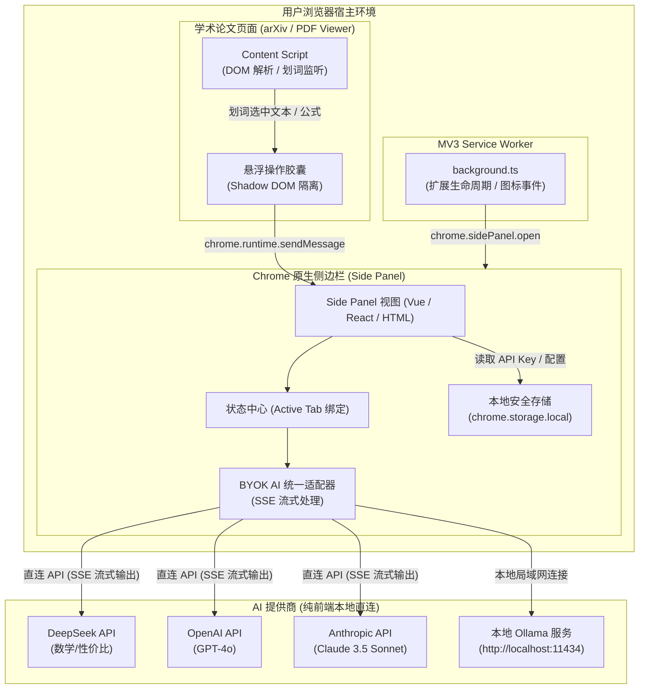

# 🏗️ 02-系统架构设计说明书 (Architecture Design)

> **文档状态**：已批准 (Approved)  
> **技术标准**：Chrome Manifest V3  
> **核心框架**：WXT (Next-gen Web Extension Framework) + TypeScript + TailwindCSS

---

## 1. 系统全景架构图



---

## 2. 关键架构技术选型

### 2.1 为什么采用 WXT？
传统 Web 扩展开发面临以下工程痛点：
1. **Manifest V3 打包繁琐**：传统的 Webpack / Rollup 配置难以优雅处理 Service Worker 的单入口机制与 Side Panel 声明。
2. **样式污染**：注入页面的 Content Script CSS 经常与宿主页面冲突。
3. **多浏览器适配难度高**：
* **WXT 的解决方式**：
  * 基于 Vite 驱动，原生提供毫秒级 HMR（热模块重载）；
  * 开箱即用的 `entrypoints/` 约定式路由，自动生成严格符合 MV3 规范的 `manifest.json`；
  * 内置针对 Content Script 的 **Shadow DOM API**，实现完全沙箱化的样式隔离；
  * 支持一键构建 Chrome、Firefox、Edge 跨浏览器产物。

### 2.2 Chrome Side Panel API 原生集成
* 在 `manifest.json` 中声明：
  ```json
  "permissions": ["sidePanel", "storage", "activeTab"],
  "side_panel": {
    "default_path": "sidepanel/index.html"
  }
  ```
* **生命周期策略**：
  * 在 `background.ts` 中配置 `chrome.sidePanel.setPanelBehavior({ openPanelOnActionClick: true })`，用户点击扩展图标时，直接呼出原生侧边栏，不再弹出任何浮动 Popup。

---

## 3. 跨上下文通信协议 (Message Passing Protocol)

为确保 Content Script、Background 与 Side Panel 之间的高内聚低耦合，采用标准化的 Action 消息总线：

```typescript
// 消息协议定义 (src/types/messages.ts)
export interface SelectionMessage {
  action: 'SELECTION_TEXT_CAPTURED';
  payload: {
    selectedText: string;
    pageTitle: string;
    pageUrl: string;
    isFormula: boolean;
  };
}

export interface PaperMetadataMessage {
  action: 'PAPER_METADATA_EXTRACTED';
  payload: {
    title: string;
    authors: string[];
    abstract: string;
    arxivId?: string;
    pdfUrl?: string;
  };
}
```

---

## 4. BYOK (Bring Your Own Key) 统一适配器设计模式

为实现 0 服务器开销并支持多个主流大模型，采用策略模式（Strategy Pattern）封装统一流式接口：

```typescript
// 核心接口规范
export interface ChatMessage {
  role: 'system' | 'user' | 'assistant';
  content: string;
}

export interface StreamCallbacks {
  onChunk: (delta: string) => void;
  onError: (error: Error) => void;
  onFinish: (fullText: string) => void;
}

export interface AIProvider {
  streamChat(
    messages: ChatMessage[],
    callbacks: StreamCallbacks,
    options?: { model?: string; temperature?: number }
  ): Promise<void>;
}
```

### 安全模型说明
1. **本地存储隔离**：用户输入的 API Key 严格使用 `chrome.storage.local` 进行加密存储，不在任何代码或网络请求中上传至第三方服务器。
2. **直连免中转**：前端直接利用 `fetch` API 发送包含 `Authorization: Bearer <KEY>` 的 SSE 请求。
3. **CORS 跨域解决方案**：
   * 在 Manifest V3 中，Side Panel 运行在独立的扩展扩展源（`chrome-extension://<EXTENSION_ID>/`）下；
   * 通过在 `manifest.json` 中的 `host_permissions` 声明相应的 API 域名（如 `https://api.deepseek.com/*`, `https://api.openai.com/*`, `https://api.anthropic.com/*`），扩展拥有直接跨域发起请求的原生能力，**无需借助任何后端代理服务器**。
